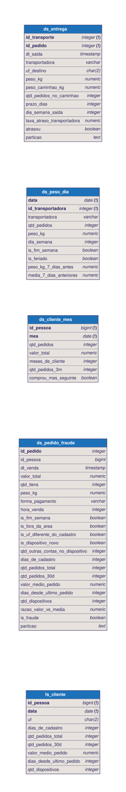

# 📐 Modelagem — os desenhos e as respostas

> ⬅️ [README principal](../README.md)

Esta pasta guarda o **desenho** do que você recebe e do que você constrói.
Você vai consultá-la durante a trilha inteira.

| Pasta / arquivo | O que é | Quando usar |
|---|---|---|
| [`dbml/dw_recebido.dbml`](./dbml/dw_recebido.dbml) | o Data Warehouse que você **recebe**: 7 dimensões e 4 fatos, com a explicação de cada coluna | etapa 1, e sempre que tiver dúvida sobre uma coluna do DW |
| [`dbml/analytics.dbml`](./dbml/analytics.dbml) | o **contrato** das cinco tabelas que você constrói: grão, colunas e a regra de cada uma | etapas 3 a 7. É este arquivo que o `make conferir` lê |
| [`img/`](./img/) | os dois modelos desenhados como diagrama | para olhar sem abrir o `.dbml` |
| [`gabarito/`](./gabarito/) | o SQL de referência de cada tabela | só quando travar (`make gabarito t=<tabela>`) |

## Como ver um `.dbml` como diagrama

As imagens prontas estão em `img/`. Para navegar com zoom, abra
[dbdiagram.io/d](https://dbdiagram.io/d), apague o exemplo que aparece à
esquerda e cole o conteúdo do arquivo. O diagrama se desenha sozinho.




## Como ler o contrato

Cada tabela do `analytics.dbml` começa com um comentário que diz o **grão**, e
cada coluna tem uma nota com a **regra**:

```text
// GRAO: 1 linha por cliente por dia.
Table fs_cliente {
  id_pessoa bigint [not null]
  data date [not null, note: '...']
  qtd_pedidos_total integer [note: 'pedidos feitos ANTES deste dia']
  ...
  indexes {
    (id_pessoa, data) [pk]     <- a chave: o grão em forma de colunas
  }
}
```

A conferência usa o contrato de três formas: as colunas e os tipos têm que
existir; a chave (`pk`) não pode se repetir; e o conteúdo é comparado com uma
**referência** construída a partir do gabarito.

## Sobre o gabarito

O notebook de cada etapa já traz o SQL da tabela, comentado, para você ler e
rodar. O gabarito é o mesmo SQL, guardado aqui para duas situações:

* você editou a célula, quebrou a tabela e não sabe voltar: `make gabarito t=<tabela>`;
* você quer pular uma etapa e precisa da tabela dela (a etapa 4 depende da 3).

Nos desafios, o Júnior pede para concluir a trilha **sem** usar o gabarito.
