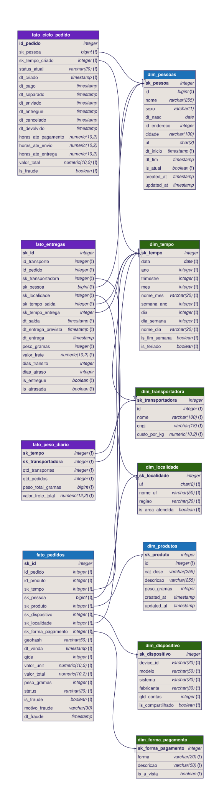

# 1️⃣ Conhecer o Data Warehouse

> ⬅️ [README principal](../../README.md) · Etapa 1 de 8

| | |
|---|---|
| **Notebook** | `notebooks/01_conhecer_o_dw.ipynb` |
| **Você constrói** | nada: esta etapa é de leitura |
| **Tempo** | 20 minutos |

## 🎯 Por que esta etapa existe

Você recebeu um Data Warehouse pronto, em *star schema*. Ele foi desenhado para
responder perguntas de negócio ("quanto vendemos por UF?"), não para treinar modelos.
Antes de tirar uma única feature dele, você precisa saber três coisas sobre ele — e
cada uma é uma armadilha que aparece de novo na etapa 2:

1. **O grão de cada fato.** A `fato_pedidos` tem uma linha por **item**, não por pedido.
2. **O DW guarda o passado.** A `dim_pessoas` tem uma versão por endereço da pessoa
   (SCD tipo 2): juntar pelo `id` multiplica linhas.
3. **O rótulo chega atrasado.** A fraude é confirmada dias depois da compra
   (`dt_fraude`): os pedidos mais recentes parecem "limpos" sem ser.



O desenho completo, com a explicação de cada coluna, está em
[`modelagem/dbml/dw_recebido.dbml`](../../modelagem/dbml/dw_recebido.dbml).

> 📺 **Para revisar** (opcional, ~9 min). Quer ver como um Data Warehouse como este
> é construído? Os dois vídeos abaixo mostram a passagem do transacional para o
> modelo dimensional, no ambiente da disciplina de engenharia:
>
> - [Data Modeling 05 - Avançando para uma modelagem dimensional](https://www.youtube.com/watch?v=DZi_7rLBguk&list=PLD3-a_5KsN3mBrcfHfB8i3erZf_9eqfw8&index=6)
> - [Data Modeling 06 - Construindo meu Data Warehouse (DW)](https://www.youtube.com/watch?v=7iB8tvWbVpw&list=PLD3-a_5KsN3mBrcfHfB8i3erZf_9eqfw8&index=7)

## ▶️ Passo a passo

### 1. Confira que o ambiente está no ar

No terminal (no Windows, o do **Ubuntu**), dentro da pasta do repositório:

```bash
make status
```

```text
NAME                    SERVICE    STATUS
modelagem_ds_jupyter    jupyter    Up 2 minutes (healthy)
modelagem_ds_postgres   postgres   Up 2 minutes (healthy)
```

Os dois containers têm que estar `(healthy)`. Se não estiverem: `make subir`.

### 2. Abra o notebook

No navegador, abra **http://localhost:8899**. Na barra da esquerda, dê dois cliques em
**`01_conhecer_o_dw.ipynb`**.

### 3. Rode as células, em ordem

Clique na primeira célula de código e aperte **`Shift + Enter`**: a célula roda e o
cursor desce para a próxima. Repita até o fim, **lendo o texto entre as células** — é
ali que está o conteúdo da aula.

> 💡 Atalho: menu **Run → Run All Cells** roda tudo de uma vez. Use só depois de ter lido
> o notebook pelo menos uma vez.

O que você deve ver pelo caminho:

| Seção | O que observar |
|---|---|
| 1.1 | 5.000 pedidos e quase 15 mil linhas na `fato_pedidos` |
| 1.2 | o Ravi Rios (`id = 7`) com **duas** linhas na `dim_pessoas` |
| 1.3 | a última venda em **2026-09-01**: é o "hoje" do DW |
| 1.4 | um gráfico em que a última semana tem muito menos fraude que as outras |
| 1.5 | o seu placar, com tudo ainda em ⏳ |

## ✅ Como saber que deu certo

Não há tabela para conferir nesta etapa. Você terminou quando consegue responder, sem
olhar:

* Qual o grão da `fato_pedidos`? E da `fato_ciclo_pedido`?
* Por que `JOIN dim_pessoas USING (id)` pode duplicar linhas?
* Por que a fraude da última semana parece menor?

## 🆘 Se deu errado

| O que apareceu | O que fazer |
|---|---|
| O navegador não abre `localhost:8899` | `make status`. Se o `modelagem_ds_jupyter` não estiver `(healthy)`, rode `make subir` |
| `ModuleNotFoundError: No module named 'liga'` | O notebook foi aberto fora da pasta `notebooks`. Feche e abra pelo painel da esquerda, dentro de `notebooks/` |
| `ErroNoBanco` ou `could not connect to server` | O banco caiu ou ainda está subindo. `make status`; se precisar, `make consertar` |
| `relation "fato_pedidos" does not exist` | O DW não foi carregado. Rode `make carregar` |
| O gráfico não aparece | Rode de novo a célula do `semanas` e depois a do `plot` |

Mais casos no [FAQ](../../docs/faq.md).

## ✅ Antes de seguir

* [ ] Abri o JupyterLab e o notebook 01
* [ ] Rodei todas as células sem erro
* [ ] Sei o grão das quatro fatos
* [ ] Entendi por que a `dim_pessoas` tem mais linhas que pessoas
* [ ] Entendi por que o rótulo dos últimos dias não é confiável

---

# ➡️ Continue em [trilha/02_notebook_herdado/README.md](../02_notebook_herdado/README.md)
